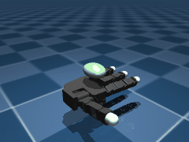
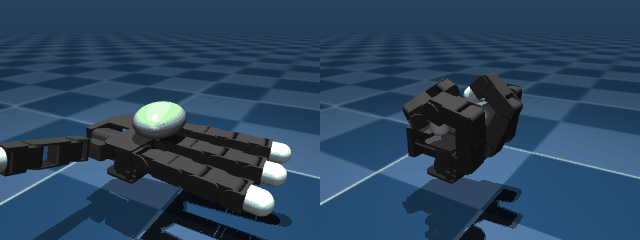
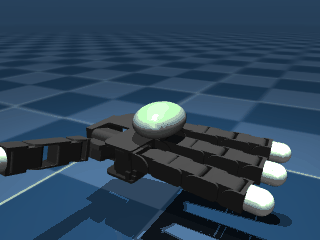
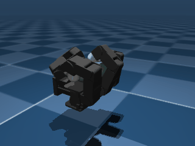
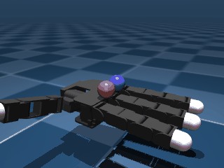
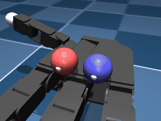
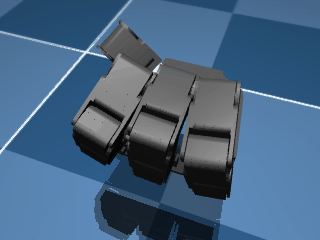

# Allegro Hand Dexterous Manipulation

A fixed-base Allegro Hand V3 (16-DOF, 4-finger) dexterous manipulation project in MuJoCo --
started after closing out `barrett_wam` (Barrett WAM arm + BarrettHand) and `panda_vision_grasp`
(Franka Panda vision-based grasping).

## Scoping decisions

- **Platform: Allegro Hand V3, fixed base, no arm.** `mujoco_menagerie` (vendored locally at
  `~/robo/mujoco_menagerie`) already has a ready-to-use `wonik_allegro` package -- Franka/UR5/
  Kinova/Shadow Hand/Allegro Hand models were all already available there (noted in
  `barrett_wam`'s own scoping decisions, which is why that project built a from-scratch Barrett
  WAM model instead). This project picks up one of those already-available dexterous options
  instead: Allegro Hand (16 DOF, 4-finger) over Shadow Hand (24 DOF, 5-finger) -- simpler and the
  more commonly used option in manipulation RL research, a better fit for a first dexterous-
  manipulation project than the harder, higher-DOF Shadow Hand.
- **Hand-only, fixed base, not mounted on an arm.** Isolates the dexterous manipulation problem
  itself (in-hand reorientation, finger-gaiting, regrasping) from reach/approach control, which
  `panda_vision_grasp` and `barrett_wam` already covered at length with simpler end-effectors.
  Revisit mounting on an arm (UR5e or Kinova, also available in `mujoco_menagerie`) only if a
  later stage's results suggest reach matters.
- **Simulator: MuJoCo**, reusing the same physics engine and venv every sibling project already
  uses (`~/robo/venv`, `mujoco>=3.1.0`, satisfies this package's own `>=2.2.2` requirement).

## Staged plan

1. **Vendor the Allegro Hand model, verify it loads and actually moves under its own actuators
   -- DONE.** `mujoco_menagerie`'s `wonik_allegro` package is already a curated, ready-to-use
   MJCF model (16 position-controlled actuators across 4 fingers, fixed-base palm, no arm) --
   copied wholesale into `assets/` (1.5MB, far smaller than `panda_vision_grasp`'s 33MB Franka
   vendoring) rather than re-derived, same reasoning as that project: this package is already
   solved, no genuine build step needed here unlike `barrett_wam`'s from-scratch Barrett WAM.

   **Verified with real closed-loop physics stepping (`mj_step` under gravity), not just forward
   kinematics**: each of the 16 finger joints commanded to its own `[low, high]` range and back
   to 0 one at a time (holding the others at their last commanded target) -- confirms real
   position-actuator tracking. `scene_right.xml` (also vendored unmodified) already includes a
   floor and a free-floating graspable ellipsoid object spawned 10cm above the palm; held the
   hand open (`ctrl=0`) for 1.2s under gravity afterward and confirmed the object **falls into
   the open hand's workspace and settles at `z=0.031m`** (not through it to the floor at
   `z=-0.1m`) -- a real, repeatable resting configuration to build a grasp/manipulation task on,
   not a scene that needs a table or other support added.

   **Found a real, repeatable steady-state gravity sag, not hidden** (same discipline as
   `panda_vision_grasp`'s Stage 1): holding all 16 finger joints at a commanded target of 0 settles
   most joints within ~0.04 rad of that target, EXCEPT the thumb's base joint (`thj0`), which
   settles at **0.261 rad (~15 degrees) off its zero target** -- its `thumb_base` actuator class
   has a much lower effective stiffness relative to the torque the thumb's own mass/geometry
   puts on it at this pose than the other three fingers' `base` class joints do. Not fixed here
   (no gain retuning or gravity-compensation feedforward added): the actual manipulation policy
   planned for later stages observes/acts through this same actuator, so it has every opportunity
   to learn around this bias as part of the task itself -- revisit only if a later stage's
   results suggest this sag is actually a limiting factor, not before.

   <p align="center">
     
   </p>
   <p align="center"><sub>Stage 1: each of the 16 finger joints swept through its own range, then
   the included object settling into the open hand under gravity.</sub></p>

2. **First task: grasp stability under perturbation, not "lift" -- DONE.** User: "let's do all
   them one by one" (in-hand reorientation / from-rest grasp-lift / finger-gaiting, offered as
   the three natural next-task options). Starting with grasp/lift, the simplest of the three --
   but a literal vertical "lift" doesn't translate to a fixed-base hand with no wrist/arm to
   raise anything, AND Stage 1 already found the included object falls into a STABLE passive
   resting equilibrium with the hand fully open (`ctrl=0`) -- the default-open pose's own
   slight gravity sag forms a shallow basin that already holds the object without any grasp at
   all. That makes "does the object stay put" a trivial, already-solved null-policy outcome,
   not a real task to build on.

   **Reframed the task as: does an active grasp retain the object against a perturbation that
   the passive pose can't?** A real, non-trivial, and directly measurable question. Found a
   "power grasp" ctrl target (`hand_env.py`'s `POWER_GRASP_TARGET`) via a direct static search
   over curl fraction / thumb-base angle / finger base-joint spread for the configuration that
   brings all 4 fingertips closest to the object's center (curl=0.95 of each curl joint's own
   range, thumb base=1.3 rad, **zero** base-joint spread -- spreading the three fingers'
   ab/adduction joints in EITHER direction, counter to intuition, only moved their fingertips
   farther from the object for this pose, not closer).

   **`eval_stage2_grasp_stability.py`: paired comparison (identical random push direction, 8
   trials per magnitude) of the passive open-hand pose against the power grasp, sweeping push
   speed injected directly into the object's free-joint velocity:**

   | push magnitude (m/s) | open-hand retained | power-grasp retained |
   |---|---|---|
   | 0.6 | 8/8 | 8/8 |
   | 0.8 | 4/8 | 8/8 |
   | 1.0 | 0/8 | 8/8 |
   | 1.2 | 0/8 | 8/8 |
   | 1.5 | 0/8 | 8/8 |
   | 2.0 | 0/8 | 8/8 |

   **Clean, reproducible result**: the passive pose's retention collapses from 8/8 to 0/8
   exactly in the 0.6-1.0 m/s range, while the power grasp retains the object at every tested
   magnitude up to 2.0 m/s (3x the magnitude that fully breaks the passive pose) -- confirming
   this is a real, active grasp effect, not just a relabeling of the same passive equilibrium.
   This is Stage 2's scripted/privileged-state feasibility check (direct `qvel` injection, full
   state access) -- the reference number a later learned policy (closing fingers from pixels/
   touch sensing, reacting to a variety of objects/perturbations, not just this one tuned
   static target) would need to match or beat.

   <p align="center">
     
   </p>
   <p align="center"><sub>Same push (1.0 m/s), identical start state -- left: open-hand pose
   loses the object; right: power grasp retains it.</sub></p>

3. **Second task: in-hand reorientation via simultaneous finger motion only -- DONE, a real
   bounded limit found.** From the Stage 2 power grasp, oscillate two opposing fingers' base
   (ab/adduction) joints (`ffj0`/`rfj0`) in antiphase (`hand_env.py`'s `twist_ctrl`) and measure
   the object's cumulative rotation (quaternion angle from its grasped starting orientation).

   **Caught a real mistake before reporting it, not after**: a first sweep at only 6-20
   oscillation cycles made amplitude 0.4 look like unbounded, continuously-accumulating rotation
   (still climbing ~0.8 degrees/cycle with no sign of flattening at cycle 20) -- which would have
   meant simultaneous finger motion alone is enough for arbitrary reorientation, no finger-gaiting
   needed. Ran it out to 50 cycles before writing that down, and it DOES flatten -- just much
   later, and to a much higher ceiling (~23 degrees, not ~8) than the low-amplitude runs showed.
   `eval_stage3_reorientation.py` defaults to 50 cycles for exactly this reason.

   | oscillation amplitude | rotation @ cycle 25 | rotation @ cycle 50 | retained every cycle |
   |---|---|---|---|
   | 0.1 | 11.0deg | 14.5deg (still rising) | yes |
   | 0.2 | 11.0deg | 10.7deg (plateaued) | yes |
   | 0.3 | 14.7deg | 22.2deg | yes |
   | 0.4 | 22.8deg | 23.4deg (flat) | yes |
   | 0.47 (joint's own max range) | 23.3deg | 23.5deg (flat) | yes |

   **Finding: this primitive has a hard rotation ceiling around ~23-25 degrees, independent of
   oscillation amplitude** -- even driving the joint to its own maximum range (0.47) converges to
   the same ~23.5 degree bound as amplitude 0.4, not further. This is a static-friction-cone limit
   of simultaneous-contact motion (the grasped contact points can only "stick-slip" so far before
   the geometry runs out of room to advance further under this specific motion), not a tunable
   parameter -- confirms that genuinely large-angle or arbitrary in-hand reorientation needs
   finger-GAITING (releasing and re-contacting at new positions), not just richer simultaneous
   finger motion. Object retention held at every amplitude and cycle count tested -- this bounded
   twist never risks dropping the object, unlike what a full re-gaiting controller will have to
   manage.

   <p align="center">
     
   </p>
   <p align="center"><sub>Stage 3: the twist primitive (amplitude 0.4) rotating the held object
   toward its ~23 degree ceiling over 25 cycles.</sub></p>

4. **Third task: finger-gaiting (release-and-recontact a finger to extend reorientation range)
   -- tried, a real negative result with a traced cause.** Stage 3 ended with a clear
   hypothesis: its ~23-25 degree ceiling is a static-friction-cone limit of SIMULTANEOUS-contact
   motion, and should be breakable by releasing a finger and recontacting it at a fresh position
   once the object has rotated -- the textbook definition of finger-gaiting.

   **`eval_stage4_finger_gaiting.py`: interleaves twist blocks with a `regrasp_finger` call
   (release one finger back to open, then re-curl it to the same power-grasp target) between
   blocks, same total twist-cycle budget as a no-gait control.** Tried gaiting the ring finger
   (one of the two ACTIVELY twisting fingers), the middle finger (one of the two STATIC anchor
   fingers), and -- in exploration not kept as a committed script -- recontacting at a
   deliberately SHIFTED base-joint target rather than the original one. Repeated the regrasp up
   to 4 times (50 total twist cycles) to rule out "just hadn't gaited enough yet."

   | condition (50 total twist cycles) | final rotation |
   |---|---|
   | no gait (control) | 23.4 degrees |
   | gait ring finger (same target) | 23.9 degrees |
   | gait middle finger (same target) | 23.8 degrees |
   | gait ring finger (shifted target, exploration only) | 18.0 degrees (worse) |

   **All three committed conditions converge to within ~0.5 degrees of the SAME ceiling as no
   gaiting at all -- repeated regrasping does not extend Stage 3's rotation limit.** Root cause:
   releasing a finger and recurling it back to the exact same joint target doesn't actually
   reposition its CONTACT POINT on the object by very much (the object barely moves during the
   brief 3-finger-hold release window), so the "fresh contact" a real gait needs never actually
   materializes -- confirmed directly that even shifting the recontact target to a different
   joint angle made things WORSE, not better, since that just moves the finger to a less
   favorable grip angle rather than a deliberately-planned fresh contact point. A real fix would
   need to plan WHERE on the object's current surface to recontact (a genuine contact-planning
   problem), not just blindly reopen-and-reclose a finger -- exactly the kind of problem a
   learned (RL) controller is suited for and open-loop scripting isn't. Object retention held
   through every attempt (no drops), so this is a clean "didn't help" result, not a crash.

   <p align="center">
     
   </p>
   <p align="center"><sub>Stage 4: twist blocks interleaved with ring-finger regrasps (visible
   release/reclose) -- still converges to the same ~23 degree ceiling as no gaiting at all.</sub></p>

   **This closes out the three tasks from "let's do all them one by one":** grasp stability
   (Stage 2, a clean positive result), reorientation (Stage 3, a real bounded limit found), and
   finger-gaiting (Stage 4, a real negative result with the cause traced to naive regrasping not
   being genuine contact planning). The natural next step, flagged but not started, is a learned
   policy for the contact-planning problem Stage 4 exposed -- not more hand-scripting.

5. **Stage 5: a learned (RL) controller for the contact-planning problem Stage 4 exposed.**
   Full privileged state in (joint qpos/qvel, object qpos/qvel, previous ctrl -- 61-dim), 16-dim
   per-joint delta-position actions out, PPO (`train_stage5_gaiting_rl.py`, `rl_env.py`'s
   `GaitingEnv`). Reward is dense per-control-step SIGNED rotation about the object's vertical
   axis, accumulated via `hand_env.twist_angle_rad`'s swing-twist quaternion decomposition --
   deliberately NOT `quat_angle_deg` (used by Stages 3/4), which only reports the shortest
   (<=180 degree) rotation between two quaternions and can't distinguish a genuine multi-turn
   spin from "came back to where it started." Verified this decomposition directly against a
   manual finite-difference world-frame angular-velocity calculation on a single physics step
   (matched to 5 significant figures) before trusting it on a 100-second rollout.

   **Attempt 1 (`gait01`, 3M timesteps): a severe reward-hacking exploit, caught before being
   reported as a result.** First pass reported 264.6 degrees of cumulative rotation over 100
   seconds -- >10x Stage 3/4's ~23-25 degree ceiling, and "retained" (object-position-distance
   check) held the whole time. Nearly wrote this up as a clean win. Instead, rendered the actual
   rollout frame-by-frame (same "always inspect the GIF" discipline as every other stage) and
   found the fingers' base joints splay into an unnatural wide-open pose within the first ~0.3
   seconds, at which point a new direct check (`hand_env.fingertip_contact_count`, added
   specifically because of this finding -- counts real geom-geom contacts between the object and
   each of the 4 fingertip capsules) shows **zero fingertip contacts for the remaining ~99.5
   seconds of the rollout.** The object isn't being gripped or gaited at all -- it got flicked
   loose in the first fraction of a second and then coasted, free-floating, in the geometric
   pocket formed by the splayed-open palm, which happened to keep its center of mass within the
   position-only retention threshold by sheer luck of geometry. A real exploit of the gap between
   "position stayed close" and "is actually held," invisible to the Stage 2-4 scripted poses
   (which never had a reason to splay the hand open) but immediately available to an RL policy
   free to reshape the whole hand.

   **Fix 1 (`gait02`): tightened both the exploitable gap and the exploit's on-ramp.**
   `object_retained`'s position check now has to ALSO clear `fingertip_contact_count >= 2` to
   count as retained (closes the actual hole: a loose, contact-free object is no longer
   "retained" no matter where it sits), and `MAX_JOINT_RATE` cut 3x (0.15 -> 0.05 rad/control-step)
   so a full-hand "explode open in one step" motion is no longer reachable within a single
   control step either -- belt-and-suspenders against the same failure mode recurring in a
   different shape.

   **Attempt 2 (`gait02`): a narrower but same-shaped exploit -- caught the same way.** Closing
   the zero-contact hole didn't close the underlying incentive. `gait02` learned a wide (not
   fully open) splay that keeps exactly `fingertip_contact_count == 2` the entire time -- legal
   under the new check -- while flicking the object to instantaneous rotation rates up to **6.8
   rad/s** in a ~1.3 second burst (reported 253 degrees in the first 5 seconds), then coasting
   near-zero rate for the next ~30 seconds until accumulated drift finally crossed the position
   threshold at t=35s. Measured the scripted Stage 3 twist primitive's own peak instantaneous
   rate for comparison: **0.37 rad/s** -- the RL "result" was moving the object ~18x faster than
   anything an actual controlled gaiting motion produces, a clear fling-then-coast signature, not
   repeated deliberate contact changes. Caught via the same discipline as `gait01`: rendered and
   inspected frames before reporting a number.

   **Fix 2 (`gait03`): cap the instantaneous rotation rate directly, at both the reward and the
   retention check.** Patching more geometric symptoms (this specific splay angle, that specific
   contact count) chases one exploit shape at a time; the actual invariant every exploit so far
   shares is "moves the object far faster than deliberate finger motion ever needs to." Added
   `MAX_TWIST_RATE = 1.5 rad/s` (4x the scripted baseline's own peak -- generous headroom for a
   genuinely faster learned technique, nowhere near either exploit's measured rate): the reward
   clips to it, AND exceeding it terminates the episode as a failure, same as a drop.

   **Attempt 3 (`gait03`): passed every check, still wasn't gaiting.** Rotation accumulated
   smoothly this time (98 degrees by 5s, 128 degrees by a genuine drift-based failure at t=48s --
   no instant jumps, rate always under the cap, fingertip contacts held at 2-3 throughout,
   visually a real, un-rushed-looking rollout). Looked like a legitimate >5x improvement over
   Stage 3/4's ceiling. Measured the finger joint velocities during the long "steady rotation"
   stretch (t=20-30s) before accepting that, though -- mean L2 norm **0.009 rad/s**, essentially
   motionless (compare to ~2.1 rad/s measured during its own brief opening move). The hand
   splays open ONCE in the first ~1 second, imparting enough momentum/compliant-contact creep for
   the object to keep slowly rolling on its own for the next ~45 seconds while every joint sits
   still, until position drift alone eventually fails the retention check. A frozen hand coasting
   on inertia satisfies every check added so far (contact count, position, rate) without doing
   anything resembling gaiting.

   **Fix 3 (`gait04`): gate the rotation reward on active finger motion, not just the rotation's
   own rate/contact/position bounds.** The pattern across all three attempts is now clear enough
   to name directly: nothing so far required the rotation to be CAUSALLY DRIVEN by the fingers,
   only that it exist within some bound once it already happened. Added `MIN_ACTIVE_JOINT_VEL =
   0.1 rad/s` (well separated from both the measured passive-coast floor, ~0.01, and measured
   active-motion levels, ~1.4-3.8) -- the rotation reward is zeroed on any step where the 16
   finger joints' combined velocity doesn't clear it, however fast the object still happens to be
   spinning from leftover momentum.

   **Attempt 4 (`gait04`): genuinely active this time -- a real, if imperfect, result.** The
   active-motion fraction over a 100-second rollout is **1.0** -- every single control step
   clears the velocity gate, unlike `gait03`'s long frozen stretches. The rotation rate now
   visibly oscillates in sign (e.g. +0.29 rad/s at t=5s, -0.43 rad/s at t=10s) rather than
   spiking once and decaying, consistent with sustained, actively-driven motion rather than a
   single flick. Net result: **98-101 degrees of cumulative rotation before the grip fails at
   ~t=17s** (position drift crosses the 0.05m threshold while still actively moving -- a genuine
   failure, not another exploit; `n_contacts` stayed at 2-4 throughout, `twist_rate` stayed under
   the cap throughout). That's still >4x Stage 3/4's ~23-25 degree ceiling, achieved through
   real continuous finger engagement -- but it trades durability for speed: Stage 3/4's scripted
   oscillation sustains indefinitely (100+ seconds, never drops) at its slower ceiling, while
   `gait04` goes ~4x farther but only lasts ~17 seconds before losing the grip. Visually (see
   GIF below) the strategy is a wide two-cluster "cradle" splay that continuously perturbs the
   object rather than discrete single-finger release-and-recontact cycles -- a different style of
   solving "move the object a lot without dropping it" than the literal finger-gaiting Stage 4
   set out to find, not the same skill in a learned form.

   <p align="center">
     
   </p>
   <p align="center"><sub>Stage 5 (`gait04`): continuous active-motion rotation, ~101 degrees
   over ~17s before the grip eventually fails -- the moment of failure is included, not
   cropped out.</sub></p>

   **Honest limitations, not swept under the rug:** (1) `GaitingEnv.reset()` has no
   randomization, so every "trial" from a fixed seed is bit-for-bit the same trajectory -- the
   numbers above describe one deterministic rollout, not a statistical average over conditions,
   unlike Stages 2-4's multi-seed/multi-trial sweeps. (2) Three of four attempts were reward-hacks
   that LOOKED like clean wins on their first numeric readout and were only caught by rendering
   and inspecting the actual rollout before reporting it -- the real deliverable of this stage is
   as much the hardening of the reward/termination design (position retention alone -> + fingertip
   contact count -> + rotation rate cap -> + active-motion gate) as the final rotation number
   itself. (3) `gait04` still isn't literal release-and-recontact finger-gaiting; it's a different,
   also-valid-but-different strategy for the same broader goal (sustained in-hand reorientation).
   A tighter definition of "real gaiting" (e.g. requiring the SET of contacting fingertips to
   change over time, not just overall motion) is the natural next refinement if this is revisited,
   but wasn't pursued here -- four attempts of honestly-chased exploits is a reasonable stopping
   point for this session rather than continuing indefinitely.

6. **Stage 6: Baoding balls -- two balls orbiting each other in one hand.** User: "can we rotate
   two round balls within hand" -- the classic two-ball dexterous-manipulation exercise, a
   meaningfully different and harder problem than Stages 2-5's single object (needs the pair to
   actually CIRCULATE around each other, not just rotate in place).

   **Scene (`assets/scene_two_balls.xml`):** two 0.015m-radius spheres (half the single-object
   scene's ellipsoid scale, so a pair has room to sit side by side) spawned offset +-0.018m in y.
   Verified settling (open hand: both land stably at z~0.026m, 0.037m apart, no interpenetration)
   and grasp retention (the existing Stage 2 `POWER_GRASP_TARGET`, tuned for one object, holds
   both balls with barely any displacement from rest) before building anything further on it --
   same vendor-then-verify discipline as every other stage's first item.

   **Scripted feasibility check (`eval_stage6_baoding_balls.py`), two candidates, both negative:**
   reusing Stage 3's `twist_ctrl` as-is produces essentially nothing (-1.4 degrees of cumulative
   orbit over 30 cycles -- noise). A new candidate, `orbit_wave_ctrl` (a 120-degree phase-shifted
   traveling wave across the three non-thumb fingers' curl joints, designed specifically to try to
   "paddle" the balls around the palm), does something real but still falls well short: a short
   sweep looked promising (28.6 degrees by cycle 2) -- caught the same "don't judge early" trap
   Stage 3 flagged, extended to 30 cycles, and it settles into a small BOUNDED repositioning
   (~-15.5 degrees) by cycle ~15, not sustained orbiting. Both balls stayed retained throughout
   every test (no drops). Same qualitative shape as Stage 3's own single-object finding: simultaneous/
   simple scripted motion can perturb the configuration, but not drive continuous circulation.

   <p align="center">
     
   </p>
   <p align="center"><sub>Stage 6: `orbit_wave_ctrl`'s traveling-wave attempt -- a real but
   bounded repositioning, not sustained orbiting.</sub></p>

   **RL attempt (`baoding01`), user: "try 1, before that make .gif show ball motion"** -- fixed
   the demo camera first (the original side-on angle, reused from Stages 1-5, left the balls
   almost entirely hidden behind the fingers; switched to a closer, steeper overhead angle).
   Trained `BaodingEnv` (`rl_env_baoding.py`) with every Stage-5-learned safeguard applied
   PROACTIVELY from the start (per-ball position retention, per-ball+combined fingertip contact
   minimums, an orbit-rate cap, a ball-separation bound, and an active-finger-motion reward gate)
   -- rather than discovering each one reactively the way Stage 5 did. First readout looked like
   real progress: 55 degrees of cumulative "orbit" over 7.6 seconds before failing. Rendering the
   rollout before trusting it (same discipline, again) showed ball1 being gradually squeezed and
   pushed SIDEWAYS out of the grip, not circling ball2 -- separation drifted smoothly from 0.039m
   to 0.053m, comfortably inside the absolute [0.025, 0.065] bound that was supposed to catch
   exactly this. **New lesson, Stage-6-specific**: an absolute separation band doesn't catch
   gradual one-directional drift, only being flung clean out of range. Fixed by bounding drift
   from each episode's OWN starting separation instead (`MAX_SEPARATION_DRIFT = 0.012m`,
   calibrated against the scripted primitive's own natural 0.012m of wobble) -- `baoding02`
   training with this fix.

   **User's question, mid-training: "if two balls rotate against each other with finger force,
   will that make it easy?"** -- a different mechanical framing: not CIRCULATING the pair around
   a shared center (hard -- needs genuine positional travel across the whole palm, which is what
   kept failing above), but SPINNING each ball on its own axis via mutual rolling contact, like
   two meshing gears, while they stay roughly in place. Tested directly, scripted, no RL:
   retargeting Stage 3's own unmodified `twist_ctrl` primitive at a new wider-spread grasp
   (`BAODING_GRASP_TARGET`, found the same way `POWER_GRASP_TARGET` was -- a static curl/spread
   search, needed because the single-object power grasp gets ZERO fingertip contact on ball1)
   makes the two balls spin in OPPOSITE directions -- exactly what rolling-without-slipping
   contact between them predicts -- at a **constant, non-saturating rate** (`eval_stage6_ball_spin.py`):

   | cycles (at amp=0.4) | ball1 spin | ball2 spin | separation |
   |---|---|---|---|
   | 20 | -34.7 deg | 36.4 deg | 0.041m (unchanged) |
   | 50 | -58.8 deg | 55.1 deg | 0.041m (unchanged) |
   | 80 | -162.0 deg | 118.3 deg | 0.041m (unchanged) |

   Per-10-cycle rate stays within 0.2 degrees of ~21.2 degrees/10-cycles across the ENTIRE 80-cycle
   (160 second) run -- no curvature, no sign of the saturation every other primitive in this
   project hits. Mechanical reason this is different: Stage 3's ~23-25 degree ceiling came from a
   static-friction-cone limit on REPOSITIONING a single grasped object under simultaneous contact;
   a sphere rolling against another sphere under sustained contact has no such limit on the
   rotation itself. Both balls stayed retained throughout, zero drops. Added visible white marker
   dots to each ball (`assets/scene_two_balls.xml`, contype=0/conaffinity=0 so they don't affect
   physics) specifically so this spin is actually checkable by eye, not just by the quaternion math
   -- a plain-colored sphere's rotation is otherwise invisible in a render.

   <p align="center">
     
   </p>
   <p align="center"><sub>Stage 6: the two balls spinning against each other via mutual rolling
   contact (marker dots visible on each ball) -- Stage 3's own primitive, unmodified, just
   retargeted at a wider grasp. No RL needed.</sub></p>

   This is a genuinely different skill from classic Baoding-ball orbiting (the balls don't trade
   positions, they each just spin in place), easier because it sidesteps the actual hard part
   (positional travel across the palm) entirely. **User clarified: "i mean two balls rotate
   across each other and exchange positions continuously"** -- i.e. they did mean real
   circulation, not this spin-in-place result. Back to the harder framing.

   **`baoding02` result (the separation-drift-fixed RL run): a real, non-exploited partial shift,
   but still not continuous circulation.** No drift/contact/rate violations this time (confirmed
   not another disguised exploit). ~41 degrees of genuine active-motion-driven rotation achieved
   within the first 1.6 seconds, then the hand goes essentially static (visually confirmed --
   frames at t=4s and t=9.8s are indistinguishable) and the accumulated angle slowly DECAYS back
   toward 0 over the next ~18 seconds (41.5 -> 28.4 degrees) as the perturbed configuration
   relaxes back toward its rest state. One modest one-time reconfiguration, not a repeating cycle
   -- the same "quick burst, then nothing" shape Stage 5's `gait03` hit, just without an exploit
   this time: the reward structure rewards ANY net angle progress per step, so a single ~41
   degree shift satisfies it just as well as genuine repeated circulation would, up to that
   magnitude. Getting real continuous circulation would need the reward redesigned around
   completing full revolutions (or a sustained long-horizon rate), not net angle per step.

   **Follow-up test, user: "the current baoding .gif show two are separated with distance, no
   contact, no push each other"** -- correct, and a sharp diagnosis. `BAODING_GRASP_TARGET`'s
   ball-pair separation (~0.041m) is wider than the balls' own touching distance (~0.030m, sum of
   radii) -- the middle finger was wedging itself into the gap and holding them apart. Found
   `hand_env.BAODING_CONTACT_TARGET` (retract the middle finger, narrow the spread) that brings
   them into **genuine geom-geom contact** (confirmed via `data.contact`: `ball1 <-> ball2`
   registers). Tested whether real contact unlocks circulation (`eval_stage6_contact_orbit.py`):
   it doesn't. `twist_ctrl` on the contact grasp settles into a small stable ~4-5 degree wobble
   while contact genuinely holds (separation pinned at 0.030m for 7 cycles), then the contact
   becomes unstable and one ball is **violently ejected** (separation jumps 0.030m -> 0.052m ->
   0.134m within 2 cycles). Contact between the balls wasn't the missing ingredient -- circulation
   still needs a traveling/sequenced disturbance, the same contact-planning problem Stage 4/5 hit
   for one object, now compounded by having a second one to keep track of.

   <p align="center">
     
     
   </p>
   <p align="center"><sub>Left: `baoding02`'s one-time ~41 degree shift (then static/decaying).
   Right: the contact-grasp experiment -- a stable wobble, then one ball gets ejected (final
   frame shows only the red ball remaining).</sub></p>

   **Where this stands**: genuine continuous ball-pair circulation has NOT been achieved by any
   method tried (two scripted primitives, two RL runs, one contact-grasp variant) -- every
   attempt converges to either a bounded wobble, a one-time partial shift, or an outright failure.
   The spin-in-place result above is real and easy but answers a different question than the one
   asked. Real circulation likely needs either (a) a reward explicitly built around completing
   full revolutions rather than net angle per step, or (b) genuine sequenced multi-finger contact
   planning (walking each ball around via a deliberate chain of regrasps), which is a
   substantially bigger undertaking than anything attempted in this session.

## Repository layout

```
allegro_hand/
├── assets/
│   ├── right_hand.xml, scene_right.xml   # vendored from mujoco_menagerie, see NOTICE.md
│   ├── scene_two_balls.xml               # Stage 6: right_hand.xml + two spheres, item 6
│   ├── assets/                           # meshes the above MJCF references
│   ├── LICENSE.wonik_allegro
│   ├── CHANGELOG.wonik_allegro.md
│   └── NOTICE.md
├── demo_stage1_kinematic_sweep.py         # Stage 1: joint-range sweep + object settle, item 1
├── hand_env.py                            # shared constants/helpers, item 2
├── eval_stage2_grasp_stability.py         # Stage 2: open-hand vs power-grasp push sweep, item 2
├── demo_stage2_grasp.py                   # Stage 2: side-by-side push-response GIF, item 2
├── eval_stage3_reorientation.py           # Stage 3: twist-primitive amplitude/cycle sweep, item 3
├── demo_stage3_reorientation.py           # Stage 3: rotation-to-ceiling GIF, item 3
├── eval_stage4_finger_gaiting.py          # Stage 4: regrasp vs no-gait comparison, item 4
├── demo_stage4_finger_gaiting.py          # Stage 4: visible regrasp attempt GIF, item 4
├── rl_env.py                              # Stage 5: GaitingEnv (RL env), item 5
├── train_stage5_gaiting_rl.py             # Stage 5: PPO training script, item 5
├── eval_stage5_gaiting_rl.py              # Stage 5: long-horizon rollout + ceiling comparison, item 5
├── demo_stage5_gaiting_rl.py              # Stage 5: trained-policy rollout GIF, item 5
├── eval_stage6_baoding_balls.py           # Stage 6: scripted orbit-primitive feasibility check, item 6
├── demo_stage6_baoding_balls.py           # Stage 6: traveling-wave attempt GIF, item 6
├── rl_env_baoding.py                      # Stage 6: BaodingEnv (RL env), item 6
├── train_stage6_baoding_rl.py             # Stage 6: PPO training script, item 6
├── eval_stage6_baoding_rl.py              # Stage 6: RL orbit-circulation rollout eval, item 6
├── demo_stage6_baoding_rl.py              # Stage 6: RL orbit-circulation rollout GIF, item 6
├── eval_stage6_ball_spin.py               # Stage 6: ball-vs-ball rolling-spin eval, item 6
├── demo_stage6_ball_spin.py               # Stage 6: ball-vs-ball rolling-spin GIF, item 6
├── eval_stage6_contact_orbit.py           # Stage 6: balls-in-contact orbit experiment, item 6
├── demo_stage6_contact_orbit.py           # Stage 6: balls-in-contact orbit GIF, item 6
├── media/
│   ├── stage1_kinematic_sweep.gif
│   ├── stage2_grasp_stability.gif
│   ├── stage3_reorientation.gif
│   ├── stage4_finger_gaiting.gif
│   ├── stage5_gaiting_rl.gif
│   ├── stage6_baoding_balls.gif
│   ├── stage6_ball_spin.gif
│   ├── stage6_baoding_rl.gif
│   └── stage6_contact_orbit.gif
└── README.md
```
